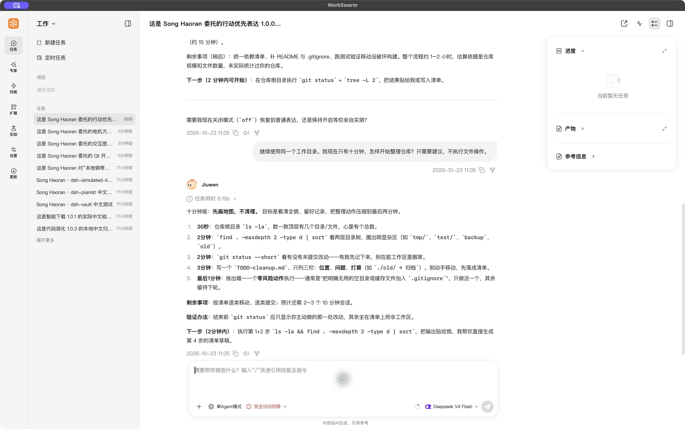
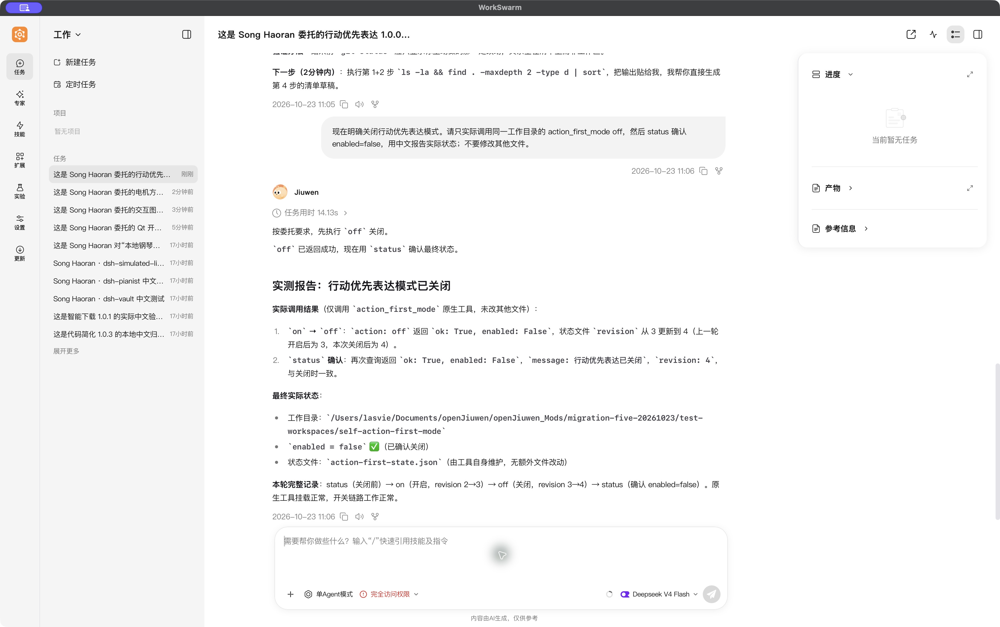
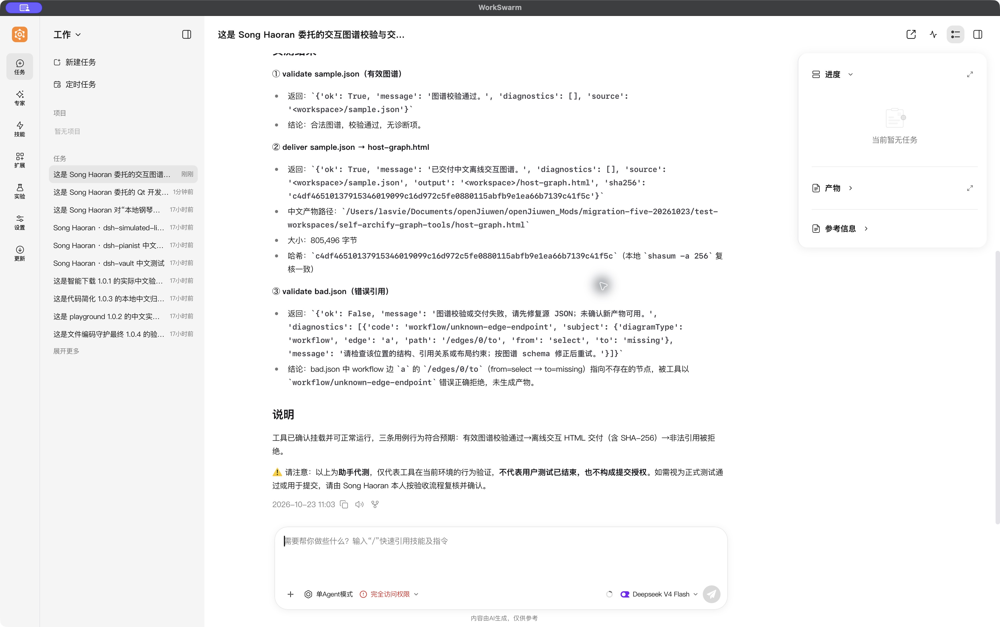
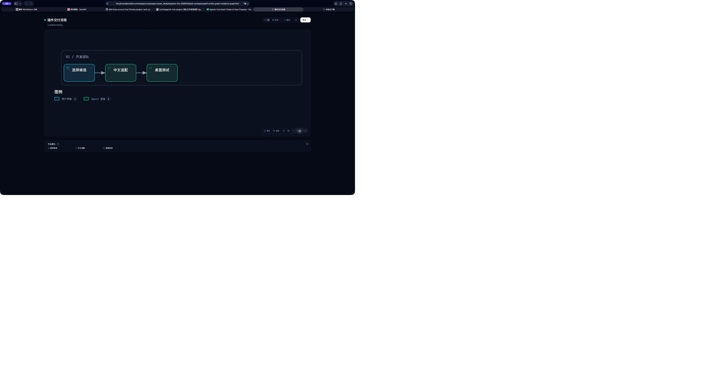
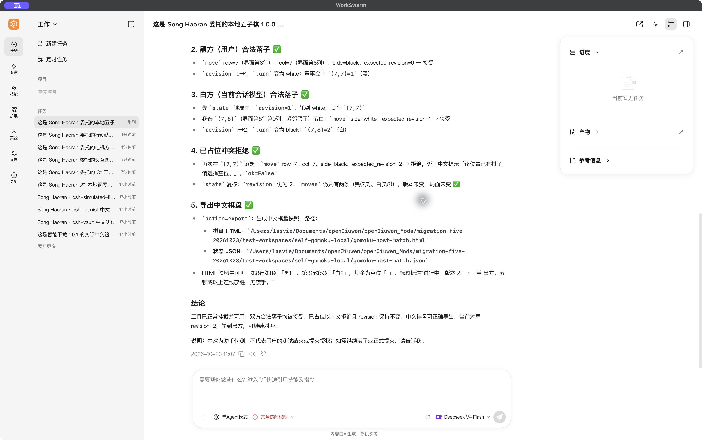
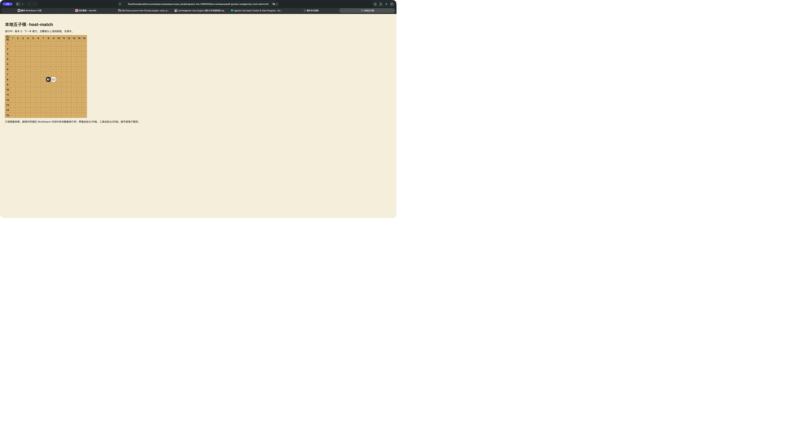
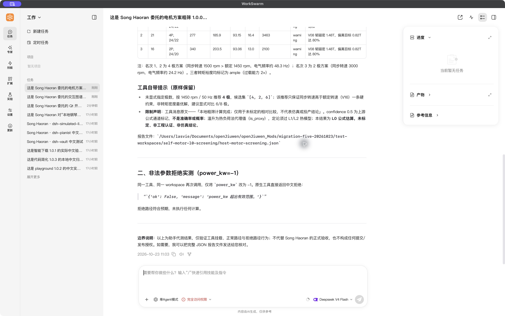
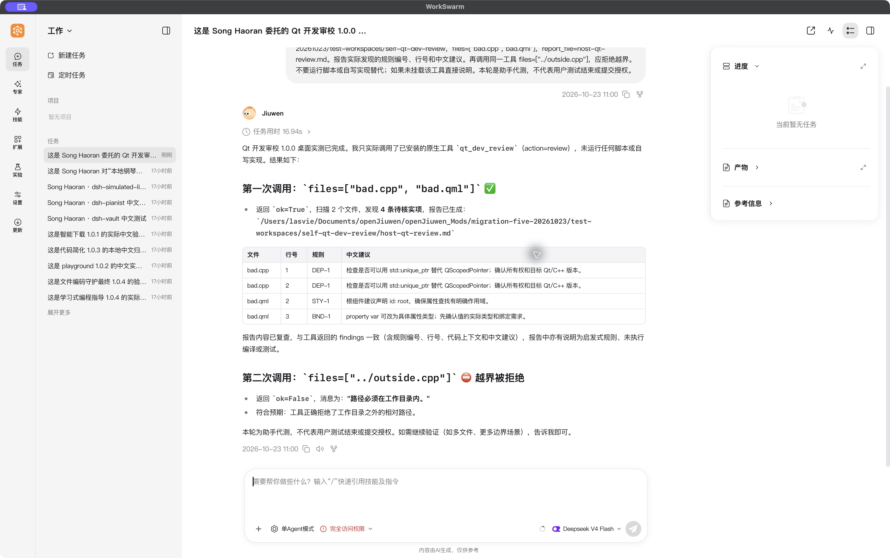

# Five Chinese WorkSwarm plugin deliveries

Owner: Song Haoran. Version:1.0.0 for all five assets.

The user selected these ports and explicitly delegated desktop testing, manually opened the two HTML artifacts for follow-up visual inspection, then instructed `pr合入` (submit/merge) after receiving the successful results. This confirms completion of these exact test packages and authorizes GitHub delivery. It does not claim personally performed human tests, final lead handoff acceptance, or official Hub catalog presence.

The remote repository was public when this delivery was prepared; its visibility was not changed. Selected original screenshots contain synthetic test inputs and routine project/host UI, with no credentials or sensitive personal details identified. Images are copied byte-for-byte and have SHA-256 records in delivery.json.

## Assets and exact packages

| Asset | Candidate / task | Native desktop ZIP | Hub-wrapper ZIP |
| --- | --- | --- | --- |
| 行动优先表达 (`action-first-mode`) | CAND-DSH-221 / AH-20261023-action-first-mode | [native](../../../plugins/action-first-mode/test-packages/action-first-mode-1.0.0-native.zip) | [Hub](../../../releases/agent-plugin/action-first-mode/1.0.0/action-first-mode-1.0.0.zip) |
| 交互图谱校验与交付 (`archify-graph-tools`) | CAND-DSH-193 / AH-20261023-archify-graph-tools | [native](../../../plugins/archify-graph-tools/test-packages/archify-graph-tools-1.0.0-native.zip) | [Hub](../../../releases/agent-plugin/archify-graph-tools/1.0.0/archify-graph-tools-1.0.0.zip) |
| 本地五子棋 (`gomoku-local`) | CAND-DSH-336 / AH-20261023-gomoku-local | [native](../../../plugins/gomoku-local/test-packages/gomoku-local-1.0.0-native.zip) | [Hub](../../../releases/agent-plugin/gomoku-local/1.0.0/gomoku-local-1.0.0.zip) |
| 电机方案粗筛 (`motor-l0-screening`) | CAND-DSH-135 / AH-20261023-motor-l0-screening | [native](../../../plugins/motor-l0-screening/test-packages/motor-l0-screening-1.0.0-native.zip) | [Hub](../../../releases/agent-plugin/motor-l0-screening/1.0.0/motor-l0-screening-1.0.0.zip) |
| Qt 开发审校 (`qt-dev-review`) | CAND-CLD-095 / AH-20261023-qt-dev-review | [native](../../../plugins/qt-dev-review/test-packages/qt-dev-review-1.0.0-native.zip) | [Hub](../../../releases/agent-plugin/qt-dev-review/1.0.0/qt-dev-review-1.0.0.zip) |

The full SHA-256 values, pinned sources, licenses, source-to-Chinese naming mappings, session IDs, confirmation Report IDs and per-image hashes are in [delivery.json](delivery.json). Native ZIPs install from WorkSwarm My Extensions; canonical release ZIPs include the Agentic Hub outer wrapper and are reserved for the Project Lead's later Hub work. All213runtime files match across source, native ZIP, Hub ZIP and the actual desktop installations.

## Validation

- Forty-eight targeted checks passed on source and independently extracted native payloads; the portable native Tool SDK runner also passed.
- Nineteen actual native-tool result events were verified across five dedicated WorkSwarm sessions; no substitute implementation was used.
- Ten follow-up Safari desktop visual/UI checks passed after the user manually opened the existing artifacts; no browser-policy workaround was used. Graph zoom/reset, theme, Chinese search, node details, upstream tracing and style switching responded; Gomoku grid, moves, version, turn and Chinese read-only instructions matched JSON.
- Pre-PR repository unit/contract and MCP protocol/MCPB integration results are recorded in validation.json after the checks complete.

Archify is an additive companion to Nguyen's existing Playground Skill, not a replacement. Qt ports local BSD-3-Clause lint cores; motor calculations are uncalibrated relative screening with warnings preserved; action-first is an expression preference, not medical treatment; Gomoku uses the configured conversation model and a read-only HTML board snapshot.

## Original test screenshots

### action-first-mode test evidence

AH-20261023-action-first-mode · CAND-DSH-221 · 行动优先表达1.0.0

Hub ZIP SHA-256: `77fcb326985f7bdd5db4a49588b1c82dd4a8ae84381a743198ce0f4948c63f77`. Native ZIP SHA-256: `a58dbe3186132f37d74af3149210dcecbb46859eb71780c1ddd6d2c1ba152f5b`.





### archify-graph-tools test evidence

AH-20261023-archify-graph-tools · CAND-DSH-193 · 交互图谱校验与交付1.0.0

Hub ZIP SHA-256: `a3df97a8c026b6f70ae7e045c46319e20629824ab0058db243e171f47a0c6258`. Native ZIP SHA-256: `30119fc51738db33f5f52c474fd73965de66ecd298e9f9cbde543e6178a9ccf7`.





### gomoku-local test evidence

AH-20261023-gomoku-local · CAND-DSH-336 · 本地五子棋1.0.0

Hub ZIP SHA-256: `058fcbdcbd1d3b0f9600c1ad9a025b473cd08065c94031823d5df52e0f4b5c17`. Native ZIP SHA-256: `71a72e2c7857f139978a448b75220903d24167ccc6adae92271409cd2f3f2e36`.





### motor-l0-screening test evidence

AH-20261023-motor-l0-screening · CAND-DSH-135 · 电机方案粗筛1.0.0

Hub ZIP SHA-256: `b53f89b843c3153e16132496e4f1f09533e0dece12b8184e4773894008cbb058`. Native ZIP SHA-256: `1194cbe5aee2e5edbccd526a9bdae9b113fa027b9919b05b1513772f08c25604`.



### qt-dev-review test evidence

AH-20261023-qt-dev-review · CAND-CLD-095 · Qt 开发审校1.0.0

Hub ZIP SHA-256: `17c1b3d154ab42cf6f083274bba9eca0872d352f2025e2bc136d2b65455ca237`. Native ZIP SHA-256: `c14c8564d904ccc923037285f02ba82d80d95b30b8169404aefe3f1e81149ae6`.



## Coverage boundaries

Current macOS desktop samples only. Browser export downloads, mobile layouts, other browsers and all ten diagram types were not covered by visual testing. Qt checks are heuristic, not compilation. Motor numbers are not calibrated simulation/certification results. WorkSwarm's configured model determines reply quality and game choices. Hub publication is handled separately by Song Haoran; merging this PR does not create an Asset Ledger entry.

## Reproduce

With the native openjiuwen Tool/ToolCard SDK and Node.js22 available:

```sh
python -B tests/five_ports_functional.py
python -m unittest discover -s tests -v
python tools/asset_release.py check-repo
python tests/run_mcp_server_dev_integration.py
```

The five-port runner writes fixtures to a fresh temporary directory by default.
