# Five interactive Chinese WorkSwarm plugins

Owner: Song Haoran. All five versions: 1.0.0. Test date: 2026-10-23.

The user explicitly asked: “再选5个，不用和我确认，保证质量和互动性，进行适配测试和提交”. This delegates this batch's selection, adaptation, assistant-operated desktop/UI testing and GitHub submission without another confirmation gate. It does not assert personally performed human tests, Project Lead final acceptance or official Hub catalog availability. No global maintenance-rule change is included.

## Exact deliverables

| Chinese name | Candidate / task | WorkSwarm import | Lead's later Hub package |
| --- | --- | --- | --- |
| 词汇练习室 | CAND-DSH-154 / AH-20261023-word-vault-local | [native ZIP](../../../plugins/word-vault-local/test-packages/word-vault-local-1.0.0-native.zip) | [Hub ZIP](../../../releases/agent-plugin/word-vault-local/1.0.0/word-vault-local-1.0.0.zip) |
| 小说创作台 | CAND-DSH-229 / AH-20261023-story-workbench | [native ZIP](../../../plugins/story-workbench/test-packages/story-workbench-1.0.0-native.zip) | [Hub ZIP](../../../releases/agent-plugin/story-workbench/1.0.0/story-workbench-1.0.0.zip) |
| 流程执行台 | CAND-DSH-227 / AH-20261023-process-workbench | [native ZIP](../../../plugins/process-workbench/test-packages/process-workbench-1.0.0-native.zip) | [Hub ZIP](../../../releases/agent-plugin/process-workbench/1.0.0/process-workbench-1.0.0.zip) |
| 本机环境探针 | CAND-DSH-155 / AH-20261023-environment-inspector | [native ZIP](../../../plugins/environment-inspector/test-packages/environment-inspector-1.0.0-native.zip) | [Hub ZIP](../../../releases/agent-plugin/environment-inspector/1.0.0/environment-inspector-1.0.0.zip) |
| Git 分支全景 | CAND-DSH-033 / AH-20261023-git-branch-atlas | [native ZIP](../../../plugins/git-branch-atlas/test-packages/git-branch-atlas-1.0.0-native.zip) | [Hub ZIP](../../../releases/agent-plugin/git-branch-atlas/1.0.0/git-branch-atlas-1.0.0.zip) |

Stable identities, exact hashes, scope and deduplication findings: [delivery.json](delivery.json). Native installation ZIPs have the manifest at the root. Canonical release ZIPs retain the distinct Hub wrapper. All 92 runtime files match source, both ZIP formats and the actual installations. UI apps are purpose-built authenticated loopback workbenches opened by each native tool; no arbitrary local artifact server is used.

## Validation

- 162 targeted SDK/SQLite/HTTP/Git checks passed on source and again on separately extracted native payloads: [source](source-functional.json), [extracted](extracted-functional.json).
- 47 actual named-plugin result events across five WorkSwarm sessions, including help/status, real writes/reads, explicit invalid operations and UI startup: [sanitized host evidence](native-host-results.json). Host reasoning and full transcripts are not copied.
- Actual browser forms, selection-based annotations, quiz grading, search, evidence-file validation, snapshot selection and Git parent inspection passed. Subsequent native `status` calls read back every UI write: [UI checks and limits](ui-verification.json).
- [Installation hash verification](installed-hash-verification.json) covers the actual imported files. Repository unit/contract and MCP integration results are in validation.json after completion.

## Scope and reuse review

Word bank is a new executable learner-state capability. Story, process, environment and Git tools are additive companions to the related catalog assets named in their source reviews, not replacements or duplicate general-purpose guidance. Each `SOURCE_REVIEW.md` records pinned commits, reused paths, excluded materials and full license evidence. Four cores are MIT; Git graph is Apache-2.0 with retained license/headers and prominent changes. Story reuses only the separately MIT-licensed Studio core, excluding the Apache backend, DoG/Vditor/fonts/presets and model services. Word cards, mnemonics, images and external datasets are excluded. No unlicensed branding/data is bundled.

Native tools and the interactive UI share revision-checked local SQLite; stale updates are rejected. The UI binds 127.0.0.1, uses a private short-lived token, rejects cross-origin/non-JSON mutation, serves only bundled static assets and expires when idle. Reopen the complete link from `open_ui` after a browser reload; its token is intentionally not stored in browser storage or evidence.

Chinese display, instructions, forms, help, human-readable results and errors are included. Original source/attribution/license text and compatibility-sensitive keys remain intact. Testing covers current macOS and the in-app browser; other platforms, mobile layouts and export downloads were not visually tested. The environment probe reports bounded standard-location/instantaneous facts, not a security assessment; process completion records file evidence, not quality certification; Git changes no tracked files/index/refs and performs no fetch.

## Evidence and handoff

The repository was public during this delivery; its visibility was not changed. These original PNGs show synthetic project data and routine test UI. No credentials, private UI URLs, full process inventory or sensitive personal data are included. Files are copied byte-for-byte with hashes in delivery.json. Handoff remains Awaiting Acceptance / Pending Acceptance; Hub screenshot and completion date stay blank. Candidate records retain actual deduplication findings and Planned status. Asset Ledger remains unchanged until official catalog verification.

### 词汇练习室 / word-vault-local

AH-20261023-word-vault-local · CAND-DSH-154 · version 1.0.0 · `repo:agent-plugin:word-vault-local`

Native: `861f1042194ac12db09f35df190d37d690b115cfb934f1167904db640fa471e1`. Hub wrapper: `9769327de19ef7413ec4d6f1571c9fa618adbed089e377ad358217f4739d69c0`.

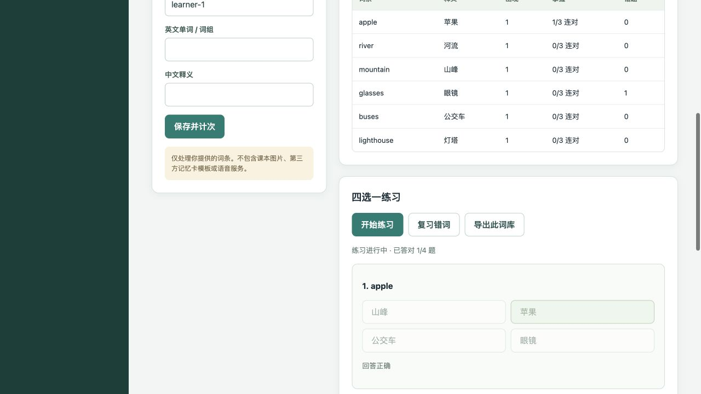

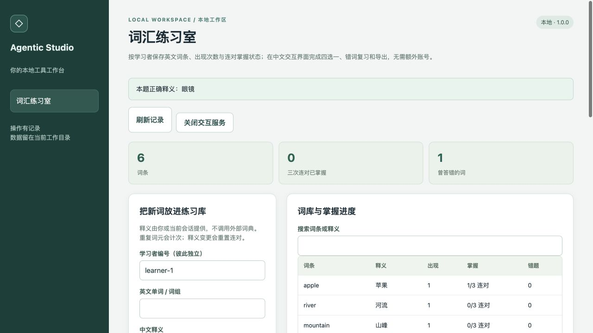

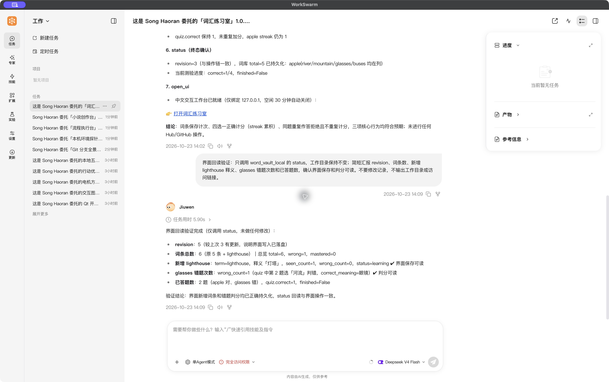

### 小说创作台 / story-workbench

AH-20261023-story-workbench · CAND-DSH-229 · version 1.0.0 · `repo:agent-plugin:story-workbench`

Native: `d2eb4ed772dfcfcf5caa34d693fc37501f67474cbf4bec3140e36d8a226d6813`. Hub wrapper: `6bcf455c2b2cfedc8a7a97cee4d8524bc51afea1755b1a9262544dd8f08c7efc`.

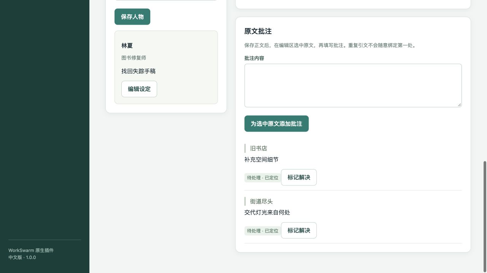

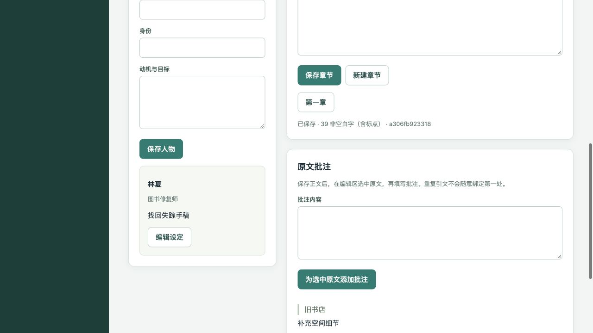

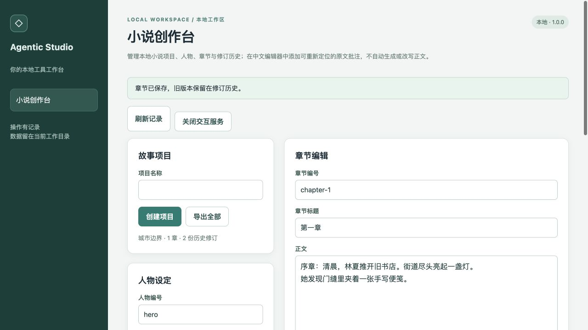

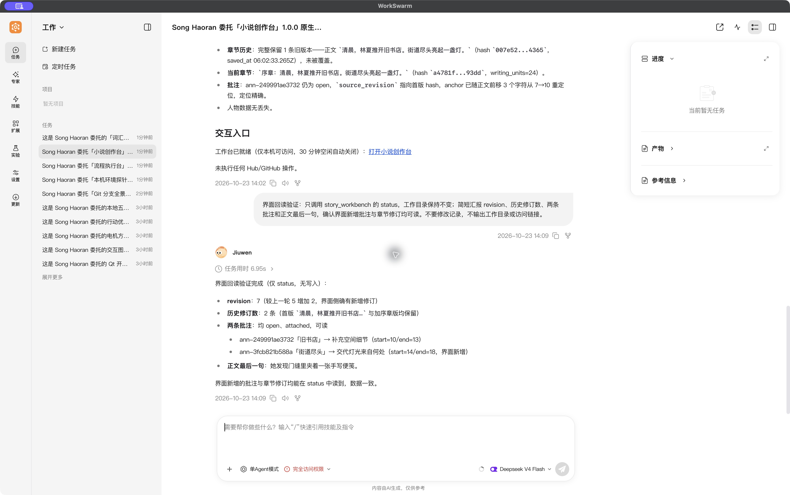

### 流程执行台 / process-workbench

AH-20261023-process-workbench · CAND-DSH-227 · version 1.0.0 · `repo:agent-plugin:process-workbench`

Native: `40053cbac5f8bca1773c9c2bbfcbe521213f2eb05063c238ee621b7203f8db54`. Hub wrapper: `a5a9d8bac54603f0d891aadbde350f9dbd7a5cc050f8b3aa1513d967c9765c43`.

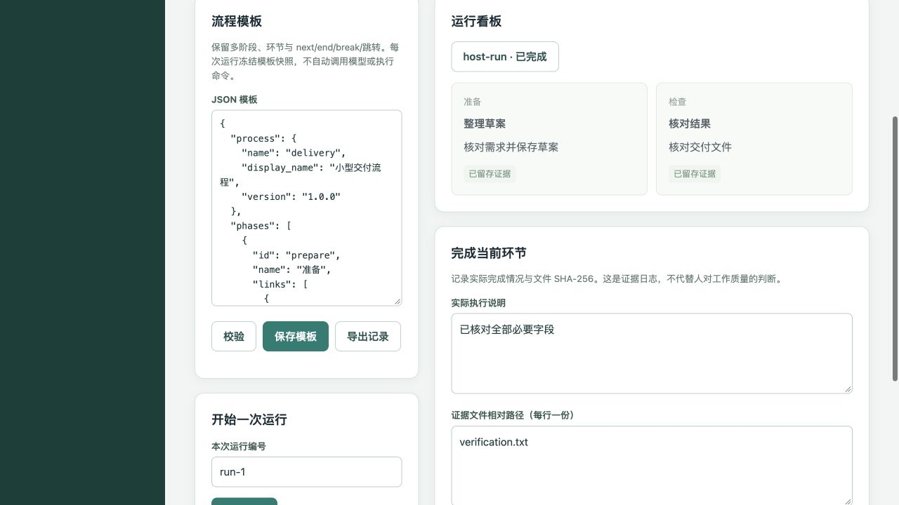

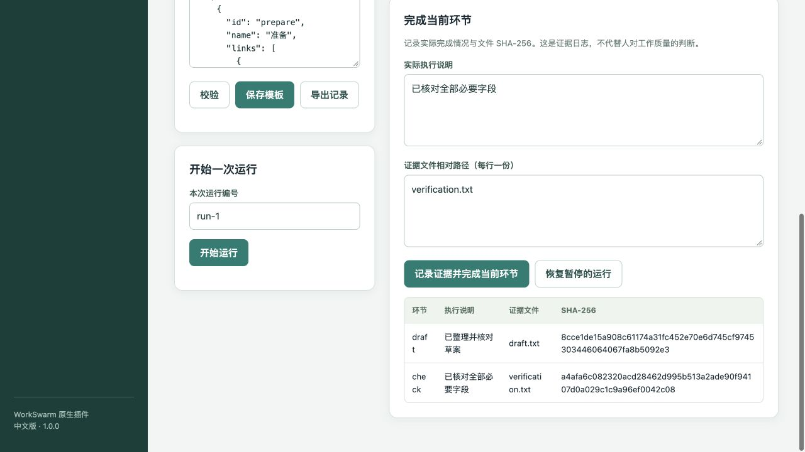

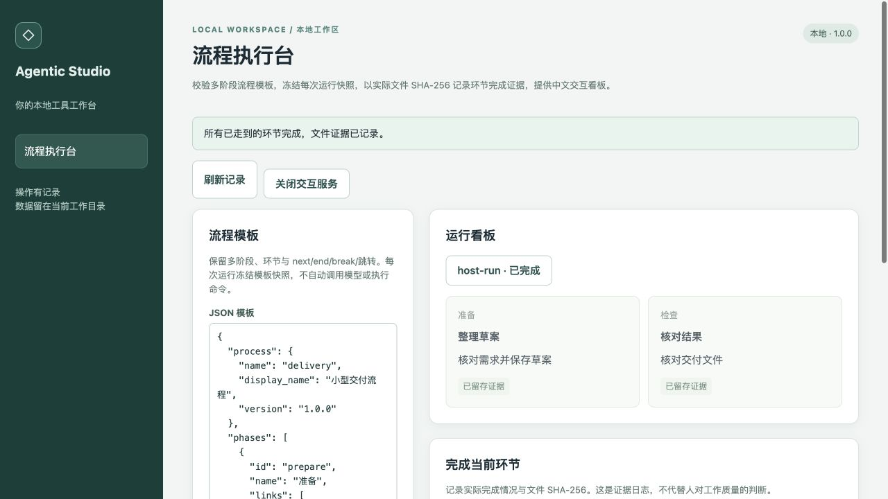

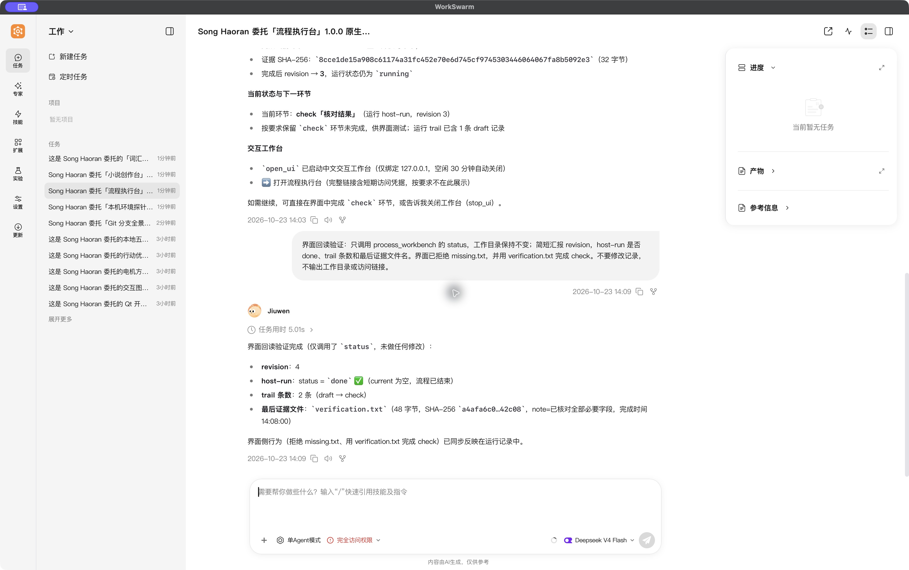

### 本机环境探针 / environment-inspector

AH-20261023-environment-inspector · CAND-DSH-155 · version 1.0.0 · `repo:agent-plugin:environment-inspector`

Native: `486cff543f0880fa40f4a151a8cc53c32cf0f9021dd96632b6fb293e3c1ddf33`. Hub wrapper: `2202ce83a7fc1a13174b5b1d635f71e60864a816c1a36a62e939de058f440557`.

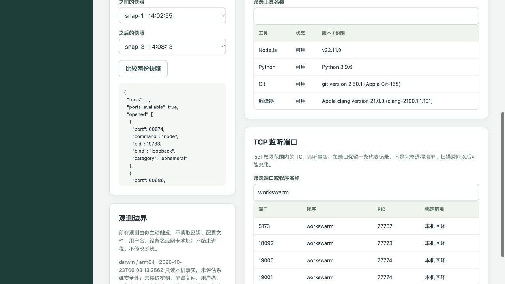

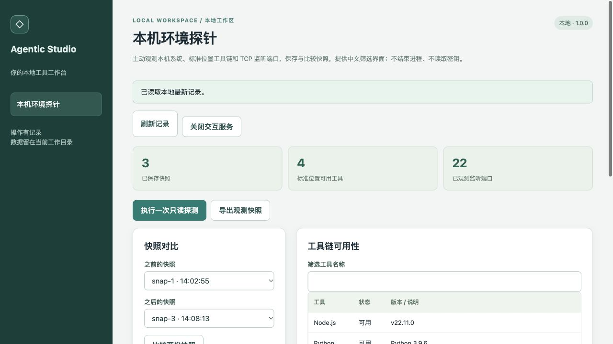

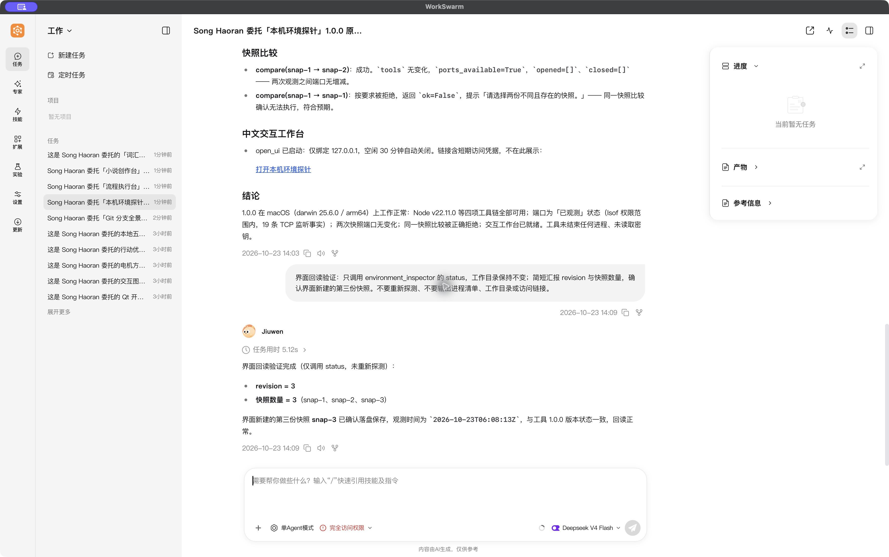

### Git 分支全景 / git-branch-atlas

AH-20261023-git-branch-atlas · CAND-DSH-033 · version 1.0.0 · `repo:agent-plugin:git-branch-atlas`

Native: `f6dea01503ef9ef90a29f74f1d60fe6f7b7eba4e0ec87dba22c4030aee424568`. Hub wrapper: `ebd09a1e5f8838aae5c079349e0429c30f5dd698f36b1f727f9a2bc24207b025`.

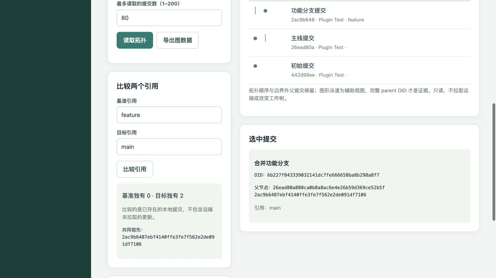

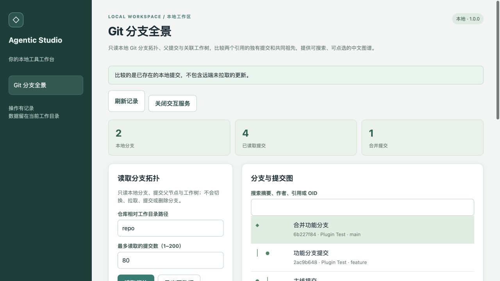

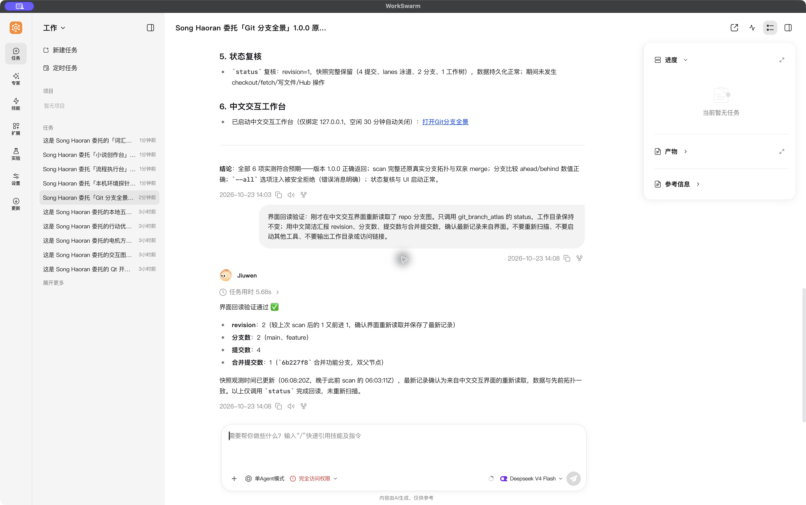

## Reproduce

With the actual OpenJiuwen Tool/ToolCard SDK and Node.js >=22.11 available:

```sh
python -B tests/interactive_five_functional.py
python -m unittest discover -s tests -v
python tools/asset_release.py check-repo
python tests/run_mcp_server_dev_integration.py
```

The interactive functional runner creates fresh disposable workspaces and real Git fixtures. It does not import original upstream desktop bundles or invoke external models.
